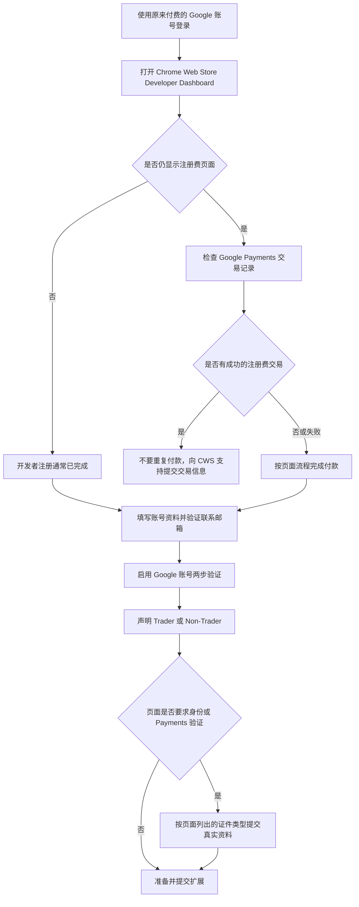

# 中国大陆个人注册 Chrome Web Store 开发者指南

> 适用对象：使用中国大陆真实身份信息、以个人身份发布 Chrome 扩展的开发者
>
> 核对日期：2026-08-07
>
> 本文只讨论 Chrome Web Store，不应套用 Google Play Console 的注册结论。

## 结论

可以尝试使用中国大陆个人的真实资料注册 Chrome Web Store 开发者，但需要把三个不同环节区分开：

1. **Chrome Web Store 开发者注册**：同意开发者协议并支付一次性注册费。
2. **开发者账号设置**：填写 Publisher name，验证联系邮箱，声明 Trader 或 Non-Trader。
3. **Google Payments 或 Trader 验证**：只有页面实际要求时，才提交身份证明、地址或支付资料。

中国大陆居民身份证属于政府签发的身份证件，但 Chrome Web Store 官方文档没有承诺“中国居民身份证在所有账号和所有验证流程中必然可用”。Google Payments 的官方规则是：接受的证件类型以账号中的验证请求页面为准。因此：

- 如果页面列出 `National ID`、`Government-issued ID` 或“身份证”，可以提交真实、有效的中国居民身份证。
- 如果页面只列出护照等其他证件，不要擅自选择不匹配的证件类型，应改用页面列出的证件或联系 Chrome Web Store 支持。
- Google 账号、Payments Profile、身份证明和地址资料中的法定姓名、国家/地区应保持一致。
- 不应通过虚假地址、借用身份、伪造国家/地区或其他规避验证的方式注册。

如果你之前已经用当前 Google 账号成功支付注册费，那么“国籍或身份证件”通常不是现在的第一道问题。应先确认这笔付款是否已被 Chrome Web Store 开发者账号识别，再决定是否需要身份验证。

## 整体流程

## 第一步：确认你当前到底处在哪个阶段

使用**之前支付注册费的同一个 Google 账号**打开：

- [Chrome Web Store Developer Dashboard](https://chrome.google.com/webstore/devconsole)
- [Google Payments Center](https://payments.google.com/)

根据页面表现判断：

### 情况 A：能看到 Items、Account 等菜单

这通常表示 Chrome Web Store 开发者注册已经完成。Google 官方说明，完成注册费支付并同意协议后，注册页面将不再出现。

此时不需要再次支付，继续完成以下事项：

- Publisher name
- 联系邮箱验证
- Trader / Non-Trader 声明
- Google 账号两步验证
- 页面提示的 Payments 或身份验证

### 情况 B：仍然显示注册和付费页面

先进入 Google Payments Center，查找对应的一次性注册费交易：

- 记录交易日期。
- 记录交易状态：成功、处理中、失败或退款。
- 保存交易 ID 和收据，但不要把完整银行卡号、身份证号或支付截图公开到 GitHub。

如果 Payments 显示交易成功，但 Developer Dashboard 仍要求付款，不要重复支付。通过 [Chrome Web Store One Stop Support](https://support.google.com/chrome_webstore/contact/one_stop_support) 提交：

- 开发者 Google 账号邮箱
- 成功付款日期
- 交易 ID
- Developer Dashboard 当前页面截图
- Payments 收据截图，遮盖不必要的支付信息

### 情况 C：提示 Payments Profile 或身份验证未完成

进入 Google Payments Center 查看右上角通知或 `Payment methods`。只有存在明确的 `Verify` 请求时，才按该请求提交资料。

不要因为看到身份验证提示就创建一个虚假海外 Payments Profile。Google Payments Profile 的国家/地区后续通常不能直接修改，错误资料可能影响整个账号的验证。

## 第二步：完善开发者账号

进入 Developer Dashboard 左侧的 `Account` 页面。

### Publisher name

这是扩展商店页面展示的发布者名称。建议提前确定长期使用的名称，例如：

- `TunnelDeck`
- `Jackie Moon`
- 一个真实拥有和维护的团队或品牌名称

开发者账号绑定的 Google 账号邮箱创建后不能直接更换；商店展示的联系邮箱则需要单独添加并验证。

如果 Payments Profile 要求选择账号类型，以个人身份、没有注册组织主体时通常应选择 `Individual`。个人资料中的法定姓名必须与身份证明一致；只有确实代表已注册公司或组织时才选择 `Business` / `Organization`，并准备对应主体文件。不要为了提高通过率选择与实际身份不符的类型。

### 联系邮箱

添加能够长期接收邮件的联系邮箱，点击验证链接完成验证。Google 会向开发者账号和联系邮箱发送审核、政策更新以及下架通知，因此应确保：

- 邮箱能接收外部邮件。
- 不会把 Google 通知自动归类为垃圾邮件。
- 账号启用了恢复邮箱、恢复手机号和安全密钥或验证器。

### 实体地址

Chrome Web Store 官方说明：如果扩展提供购买功能、付费功能或订阅，可能需要填写实体地址。Trader 验证还可能要求地址公开，具体见下一节。

## 第三步：选择 Trader 或 Non-Trader

所有 Chrome Web Store 开发者都需要声明自己是 `Trader` 还是 `Non-Trader`。这不是“个人账号”和“企业账号”的简单同义词。

- **Trader**：发布行为与商业、职业、手艺或专业活动有关。
- **Non-Trader**：发布行为处于上述商业或职业活动之外。

对于 TunnelDeck：

- 如果只是个人兴趣、免费开源实验，且不服务于商业或职业目的，可能更接近 Non-Trader。
- 如果用于品牌推广、专业服务、商业获客、付费功能或持续经营，即使开发者是个人，也可能属于 Trader。

Google 明确要求开发者自行判断，本文不能替你作法律定性。如果选择 Trader，通常需要提交法定姓名、联系电话和地址；这些 Trader 信息会显示在扩展商店页面底部，电话号码也会进行短信验证并公开展示。

在提交前应先判断是否愿意公开个人家庭地址和手机号。如果不希望公开个人信息，可以评估是否需要以真实注册的经营主体发布，但不能用与实际情况不符的主体资料。

## 第四步：身份证和 Google Payments 验证

如果页面要求上传文件，先查看验证请求中列出的 `Accepted document types`。

可能要求的资料包括：

- 法定姓名
- 出生日期
- 居住地址
- 政府签发的身份证件
- 地址证明
- 支付方式证明

提交居民身份证时建议：

1. 使用有效期内的原件拍摄。
2. 使用彩色、清晰、无反光的照片。
3. 显示证件四个角，不裁掉边缘。
4. 姓名应与 Payments Profile 中的法定姓名完全一致。
5. 只通过 Google 官方验证页面上传，不通过邮件向不明地址发送身份证。
6. 除非页面明确允许，不要自行遮挡验证所必需的信息。

Google Payments 官方说明，文档审核通常需要 **1–7 天**。是否接受某一种中国证件，应以你账号中验证请求列出的证件类型和最终审核结果为准。

## 第五步：启用两步验证

Chrome Web Store 要求所有开发者账号在发布新扩展或更新扩展之前启用 Google 账号两步验证。

建议至少配置两种恢复方式：

- 身份验证器或通行密钥
- 备用验证码或硬件安全密钥
- 可靠的恢复邮箱和恢复手机号

不要只依赖单一短信号码，否则手机停机或丢失时可能无法更新扩展。

## 第六步：确认账号已经具备发布条件

注册账号完成不等于扩展已经能够立即通过审核。第一次发布前至少检查：

- [ ] Developer Dashboard 不再显示注册费页面。
- [ ] Account 页面中的 Publisher name 已填写。
- [ ] 联系邮箱显示为 Verified。
- [ ] Google 账号已启用两步验证。
- [ ] Trader / Non-Trader 状态已经声明。
- [ ] Payments Center 没有未处理的验证通知。
- [ ] 扩展的 Store listing 已填写。
- [ ] Privacy practices 已填写，并与实际权限一致。
- [ ] 扩展需要 TunnelDeck Agent 时，商店说明中已明确告知用户。
- [ ] 为审核人员提供可执行的安装和测试说明。

## 你当前最推荐的操作顺序

由于你表示“已经付费，但还没有注册”，建议不要重新开账号，也不要重新付款，按以下顺序操作：

1. 用原付费 Google 账号打开 Developer Dashboard。
2. 判断是否仍显示注册费页面。
3. 在 Payments Center 核对注册费是否为成功状态。
4. 如果 Dashboard 已经出现 Account 和 Items，直接完成账号资料。
5. 验证联系邮箱并启用两步验证。
6. 完成 Trader / Non-Trader 声明。
7. 只有出现身份验证提示时，才查看允许的证件类型并提交身份证。
8. 如果付款成功但 Dashboard 未识别，携带交易 ID 联系 One Stop Support，不要重复付费。

## 常见问题

### 只有中国大陆身份证，没有护照，能否完成？

如果验证页面接受 `National ID` 或政府签发身份证件，可以使用中国居民身份证。如果页面明确只接受护照，则仅有身份证不能满足该次请求，需要按页面要求补充证件或联系支持。Chrome Web Store 没有公开一份适用于所有中国账号、永久不变的证件清单，因此无法在看到实际验证页面前承诺 100% 通过。

### 已经扣款，为什么还提示没有注册？

可能是登录了不同 Google 账号、交易仍在处理、支付被退款，或者 Chrome Web Store 没有正确关联该交易。先核对账号和 Payments 交易，不要立即再次付款。

### 可以选择其他国家并填写朋友的地址吗？

不建议，也不应这样做。国家、地址、付款方式和身份证明不一致会导致验证失败，并可能触发账号限制。应该使用真实居住地和真实身份资料。

### 身份证信息会公开吗？

Google Payments 表示上传的文件用于身份和付款验证。Chrome Web Store 官方列出的 Trader 公开内容是法定名称、地址和联系电话，并没有把身份证图片列为商店公开内容。但如果你声明为 Trader，上述联系信息会显示在扩展商品页面上，应在提交前了解其隐私影响。

## 官方资料

- [注册 Chrome Web Store 开发者账号](https://developer.chrome.com/docs/webstore/register/)
- [设置 Chrome Web Store 开发者账号](https://developer.chrome.com/docs/webstore/set-up-account)
- [Chrome Web Store Trader Verification FAQ](https://developer.chrome.com/docs/webstore/program-policies/trader-verification-faq)
- [Chrome Web Store Program Policies：两步验证](https://developer.chrome.com/docs/webstore/program-policies/policies#2-step-verification)
- [Google Payments：验证身份或付款信息](https://support.google.com/paymentscenter/answer/7644078)
- [Google Payments：创建和管理 Payments Profile](https://support.google.com/paymentscenter/answer/9028746)
- [Chrome Web Store One Stop Support](https://support.google.com/chrome_webstore/contact/one_stop_support)

## 免责声明

本文根据 2026-08-07 可访问的 Google 官方文档整理。Google 会根据账号、地区、风险判断和法规要求展示不同的验证步骤；实际页面列出的材料要求优先于本文。Trader / Non-Trader 属于法律身份判断，如发布行为涉及商业经营，应根据实际情况咨询专业人士。
